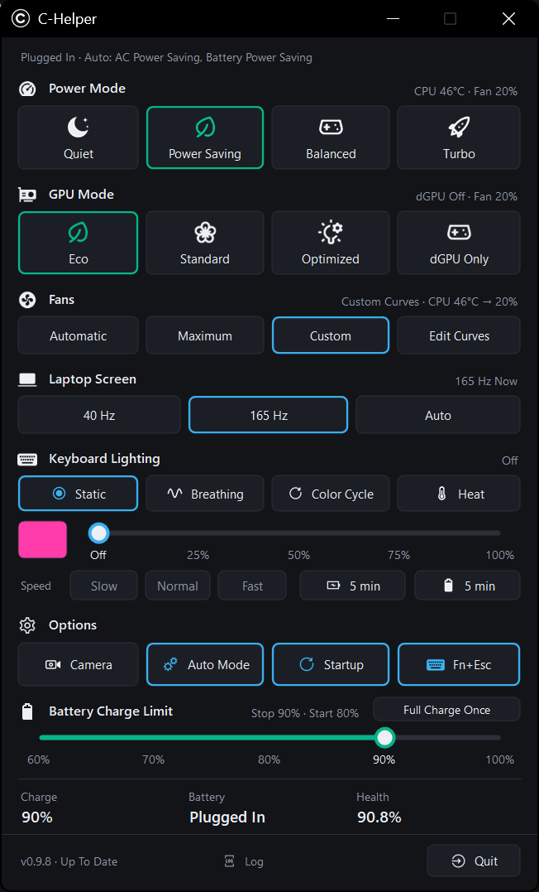
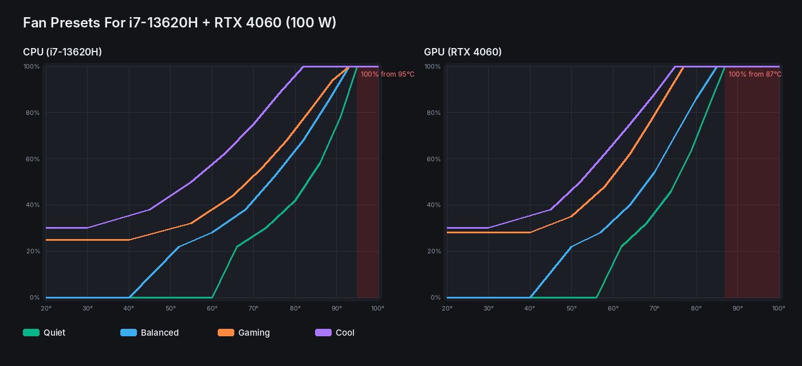

# C-Helper - Lightweight control tool for Colorful / Clevo laptops

Small and lightweight alternative to the vendor **Control Center** for the **Colorful EVOL P15 23** (Clevo / Insyde chassis), inspired by [G-Helper](https://github.com/seerge/g-helper). One portable `.exe`, a tray icon and a compact window: power modes, GPU modes, fan curves, keyboard lighting, battery charge limit and Fn keys, without the vendor app running in the background.

[](https://github.com/th4rv4/C-Helper/actions/workflows/build.yml)
[](https://github.com/th4rv4/C-Helper/releases)
[](https://github.com/th4rv4/C-Helper/releases)
[](LICENSE)

<p align="center"></p>

**[⬇️ Download the installer](https://github.com/th4rv4/C-Helper/releases/latest)** (`CHelper-Setup-x.y.z.exe`), or the portable `CHelper.exe` from the same page.

## :gift: Advantages

1. Everything the vendor Control Center does day to day, in one small window, plus things it never had (fan curves, keyboard effects, battery stats)
2. Power mode and GPU mode are **independent**: Eco no longer depends on picking Power Saving
3. Lightweight: one small exe, no services, no telemetry. Installer or portable, your choice
4. Fn keys work **without** the vendor app: C-Helper reads them straight from the BIOS
5. Simple, native UI with on-screen popups, modelled on G-Helper

### :zap: Features

1. Power modes: **Quiet** · **Power Saving** · **Entertainment** · **Performance** (the BIOS profiles, with default fan behaviour)
2. GPU modes: **Eco** · **Standard** · **Optimized** · **dGPU Only**
3. Custom **fan curves** for CPU and GPU, per power mode, with presets
4. Screen refresh rate control
5. **Keyboard lighting**: colour, brightness slider and effects (Static, Breathing, Color Cycle, CPU Heat)
6. Keyboard backlight timer, separate for plugged in and on battery
7. **Battery charge limit** (60–100 %), charge, charging / discharging watts and battery health
8. Live CPU / GPU temperature and fan speed
9. On-screen popups for Fn keys, Caps / Num / Scroll Lock, camera, touchpad and mode changes
10. Each power mode also sets the matching **Windows power mode**
11. Camera on / off, run on startup, tray menu

### :gear: Automation

- **Auto Mode**: remembers one power mode for plugged in and one for battery, and switches when you plug in or unplug
- **Optimized** GPU mode: dGPU off on battery (Eco), on when plugged in (Standard)
- **Auto** refresh rate: highest on charger, 60 Hz (or the lowest rate) on battery
- Keyboard backlight timer for charger and battery
- Settings are re-applied after sleep and when the charger is connected or removed

### :rocket: Power Modes

> [!NOTE]
> All modes are **built into the BIOS**, with their own power limits and fan behaviour. They are the **same** modes the vendor Control Center switches between.

| Mode | BIOS profile | Fans (Automatic) | Windows power mode |
|---|---|---|---|
| **Quiet** | Quiet | Noiseless curve | Best Power Efficiency |
| **Power Saving** | Power Saving | BIOS default | Best Power Efficiency |
| **Entertainment** | Entertainment | BIOS default | Balanced |
| **Performance** | Performance | BIOS default | Best Performance |

### 💻 GPU Modes

1. **Eco**: only the integrated GPU is on, the RTX 4060 is powered off (lowest power draw, coolest, quietest)
2. **Standard** (MS Hybrid): both GPUs are on, the integrated GPU drives the screen
3. **Optimized**: Eco on battery, Standard when plugged in
4. **dGPU Only** (MUX): the RTX 4060 drives the screen directly (restart required)

> [!WARNING]
> Close games and GPU apps before switching to **Eco**: anything running on the NVIDIA GPU stops when it powers off.

### 🌀 Fan Curves

Pick **Custom** in the Fans row, then **Edit Curves**. Each power mode has its own CPU and GPU curve (8 points, drag to edit), with presets tuned for the i7-13620H (TjMax 100 °C) and the RTX 4060 Laptop at 100 W (throttles around 87 °C):

| Preset | CPU | GPU | Use |
|---|---|---|---|
| **Quiet** | off until 60 °C | off until ~56 °C | browsing, light work |
| **Balanced** | off until 40 °C, steady ramp | full speed by 85 °C | everyday |
| **Gaming** | always on, moderate | full speed by 77 °C | keeps the GPU under ~78 °C so it holds its boost |
| **Cool** | 30 % minimum | full speed by 75 °C | long renders, hot rooms |



Safety: whatever the curves say, the CPU fan goes to 100 % from 95 °C and the GPU fan from 87 °C. When C-Helper quits, crashes or the PC sleeps, the fans are handed back to the BIOS automatically.

### 💡 Keyboard Lighting

Single-zone RGB: colour picker, brightness slider (applies live while dragging) and software effects:

- **Static**: one colour
- **Breathing**: fades your colour in and out (Slow / Normal / Fast)
- **Color Cycle**: loops through the rainbow (Slow / Normal / Fast)
- **CPU Heat**: green when cool, yellow, then red when the CPU is hot

Effects pause when the backlight timer turns the light off, and resume at the next key press.

### ⌨️ Keybindings

| Keys | Action |
|---|---|
| ``Fn + Esc`` | Open / hide C-Helper (brings it to the front) |
| ``Fn + Numpad /`` | Next keyboard colour, then the effects |
| ``Fn + Numpad *`` | Keyboard light on / off |
| ``Fn + Numpad -`` / ``+`` | Keyboard brightness down / up |
| ``Fn + touchpad key`` | Touchpad on / off (popup shows the real state) |
| ``Fn + camera key`` | Camera on / off |
| ``Ctrl + Shift + F5`` | Next power mode |
| ``Ctrl + Shift + Alt + F5`` | Previous power mode |

## :question: Requirements

- **Colorful EVOL P15 23** (other Clevo / Insyde laptops with the same interface may work, but are untested)
- The Clevo ACPI bridge driver (`CLEVO-acpibridge1.inf`), installed with the laptop drivers (it stays when the Control Center is removed)
- `InsydeDCHU.dll`: on first run C-Helper copies it from the vendor **"Fn hot keys and OSD"** package into `%LOCALAPPDATA%\CHelper\dchu`. After that the vendor app can be uninstalled. Builds that include it (see [vendor/README.md](vendor/README.md)) need no vendor software at all
- Windows 10 2004 or newer, 64-bit
- [.NET 8 Desktop Runtime](https://dotnet.microsoft.com/download/dotnet/8.0) (x64). The installer downloads and installs it automatically if it is missing
- Administrator rights (switching the GPU and the fans needs them). **Run on Startup** uses a scheduled task, so there is no UAC prompt at logon

## 📥 How to install

**Installer (recommended)**

1. Download `CHelper-Setup-x.y.z.exe` from [Releases](https://github.com/th4rv4/C-Helper/releases) and run it
2. Keep **Start C-Helper when I sign in** ticked
3. Quit the vendor Control Center (or uninstall it once C-Helper has run once, if your build doesn't include the vendor files)

The installer installs the .NET 8 Desktop Runtime if needed, puts C-Helper in `Program Files`, adds a Start menu entry, sets up the sign-in task and, when the build includes them, the vendor DLL and the Clevo bridge driver. Uninstalling closes C-Helper cleanly first (fans handed back to the BIOS) and removes the task.

**Portable**

Download `CHelper.exe`, put it anywhere and run it (needs the [.NET 8 Desktop Runtime](https://dotnet.microsoft.com/download/dotnet/8.0)). Turn on **Startup** in Options to start it at sign-in.

`CHelper.exe --quit` closes a running copy cleanly (used by the installer).

## 🔨 Build

```powershell
# optional: copy the vendor DLL and bridge driver from this laptop into vendor\
powershell -ExecutionPolicy Bypass -File .\tools\export-vendor-files.ps1

dotnet publish src/CHelper.csproj -c Release -o out
# -> out\CHelper.exe

# installer (Inno Setup 6)
& "${env:ProgramFiles(x86)}\Inno Setup 6\ISCC.exe" /DAppVersion=0.8.0 installer\CHelper.iss
# -> out\CHelper-Setup-0.8.0.exe
```

Every push builds the exe and the installer with GitHub Actions. Pushing a tag like `v0.8.0` also publishes a release with both and their SHA-256 checksums.

## 🔬 How it works

C-Helper talks to the hardware through the vendor's own signed `InsydeDCHU.dll`, which calls the BIOS through the Clevo ACPI bridge (`ACPI\CLV0001`). It sends the same commands the vendor app sends: nothing is patched, flashed or overclocked. Fn keys are read from the same bridge. All commands, values and which ones were confirmed on hardware are documented in [docs/PROTOCOL.md](docs/PROTOCOL.md).

The `tools/` folder has the small PowerShell scripts used to confirm each command on a real laptop.

> [!NOTE]
> ### 🔖 Important Notice
> C-Helper is **not** a driver or firmware. It selects modes and settings the BIOS already has, exactly like the vendor Control Center, plus fan curves and lighting effects done in software.
> If the vendor Control Center runs at the same time, it may re-apply its own settings. Use one or the other.

Logs are written to `%LOCALAPPDATA%\CHelper\log.txt`, settings to `%APPDATA%\CHelper\config.json`.

## Credits

- [G-Helper](https://github.com/seerge/g-helper) by seerge, for the idea, the UI style and the icons (GPL-3.0)
- [Icons8](https://icons8.com) for the icons used by G-Helper
- [tuxedo-drivers](https://github.com/tuxedocomputers/tuxedo-drivers) (Clevo ACPI interface on Linux), for the fan command reference

## License

C-Helper is released under the [GPL-3.0](LICENSE). It is not affiliated with Colorful, Clevo, Insyde or ASUS.
