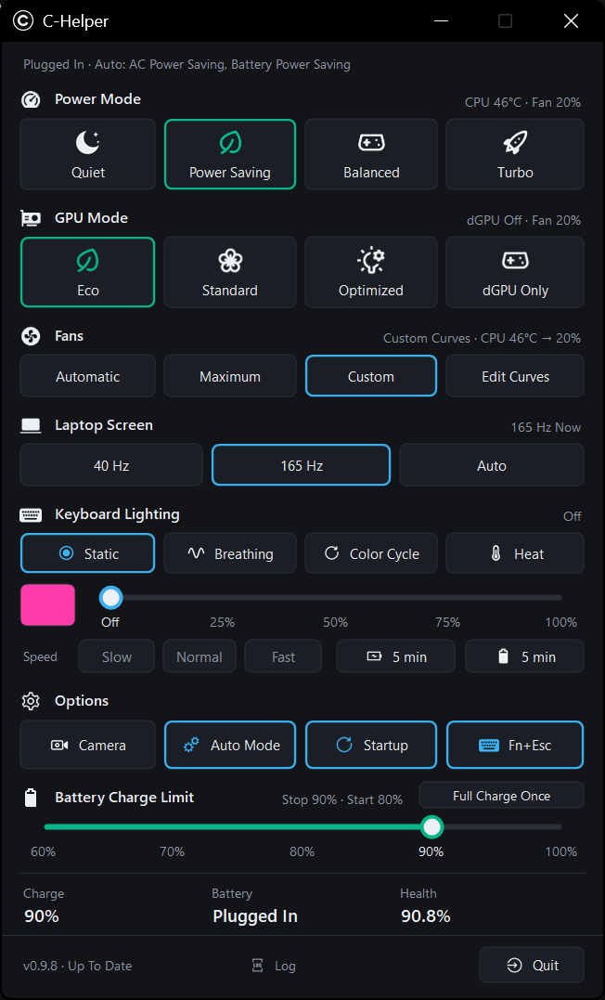
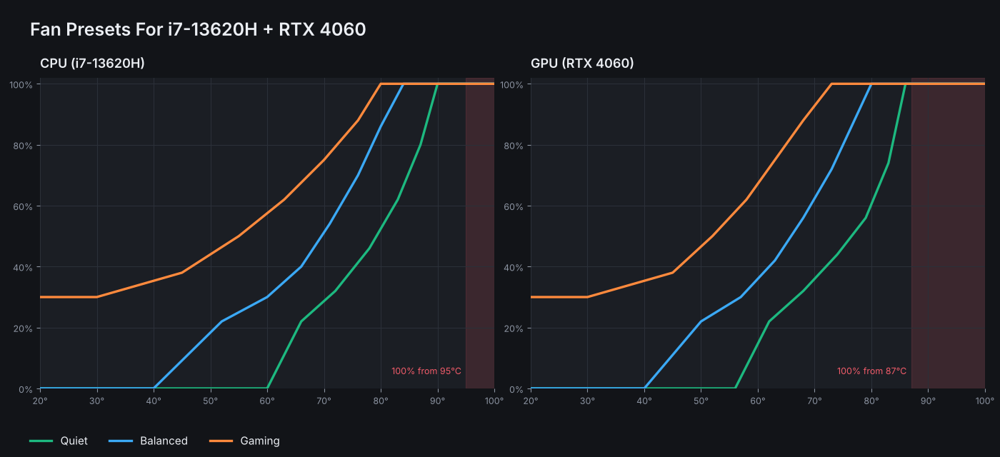

# C-Helper - Lightweight control tool for Colorful / Clevo laptops

Small and lightweight alternative to the vendor **Control Center** for the **Colorful EVOL P15 23** (Clevo / Insyde chassis), inspired by [G-Helper](https://github.com/seerge/g-helper). One portable `.exe`, a tray icon and a compact window: power modes, GPU modes, fan curves, keyboard lighting, battery charge limit and Fn keys, without the vendor app running in the background.

[](https://github.com/th4rv4/CHelper/actions/workflows/build.yml)
[](https://github.com/th4rv4/CHelper/releases)
[](https://github.com/th4rv4/CHelper/releases)
[](LICENSE)

<p align="center"></p>

**[🌐 Website](https://th4rv4.github.io/CHelper/)** · **[⬇️ Download the installer](https://github.com/th4rv4/CHelper/releases/latest)** (`CHelper-Setup-x.y.z.exe`), or the portable `CHelper.exe` from the same page.

## :gift: Advantages

1. Everything the vendor Control Center does day to day, in one small window, plus things it never had (fan curves, keyboard effects, battery stats)
2. Power mode and GPU mode are **independent**: Eco no longer depends on picking Power Saving
3. Lightweight: one small exe, no services, no telemetry. Installer or portable, your choice
4. Fn keys work **without** the vendor app: C-Helper reads them straight from the BIOS
5. Simple, native UI with on-screen popups, modelled on G-Helper

### :zap: Features

1. Power modes: **Quiet** · **Power Saving** · **Balanced** · **Turbo** (the BIOS profiles, with default fan behaviour)
2. GPU modes: **Eco** · **Standard** · **Optimized** · **dGPU Only**
3. Custom **fan curves** for CPU and GPU, per power mode, with presets
4. Screen refresh rate control
5. **Keyboard lighting**: colour, brightness slider and effects (Static, Breathing, Color Cycle, Heat)
6. Keyboard backlight timer, separate for plugged in and on battery
7. **Battery charge limit** (60–100 %) with **Full Charge Once** for trips, charge, charging / discharging watts and battery health
8. Live CPU / GPU usage, clock speed, temperature, and fan speed in % and real RPM
9. On-screen popups for Fn keys, Caps / Num / Scroll Lock, camera, touchpad, mode changes and a stopped Wi-Fi card
10. Each power mode also sets the matching **Windows power mode**
11. Camera on / off, run on startup, tray menu
12. **Network**: Wi-Fi Driver Refresh and **AdGuard DNS** (ads and trackers blocked for the whole laptop)

### :gear: Automation

- **Auto Mode**: remembers one power mode for plugged in and one for battery, and switches when you plug in or unplug
- **Optimized** GPU mode: dGPU off on battery (Eco), on when plugged in (Standard)
- **Auto** refresh rate: highest on charger, 60 Hz (or the lowest rate) on battery
- Keyboard backlight timer for charger and battery
- **Full Charge Once**: charges to 100 % this time; the charge limit comes back by itself when you unplug
- **Clamshell**: on the charger, closing the lid keeps the laptop running (with or without an external monitor). Unplug it with the lid closed and it goes to sleep. It works by switching Windows' own plugged-in lid setting to Do Nothing, and puts your setting back when turned off or when C-Helper closes
- Settings are re-applied after sleep and when the charger is connected or removed
- **Updates**: checks GitHub Releases once a day; when a newer version is out, the footer shows **Update To vX.Y.Z**. One click downloads the installer, checks its SHA-256, installs it silently and reopens C-Helper. Click the version number to check right away
- **Wi-Fi Driver Refresh**: a button in Options that removes every Intel Wi-Fi driver that has piled up on the laptop and reinstalls the last one that worked, which C-Helper keeps a copy of whenever Wi-Fi is fine (in `%ProgramData%\CHelper\WifiDriver`), along with the one before it. If the newest copy doesn't bring the card back, the refresh goes back to the previous one on its own, and it only reports Wi-Fi as working once Windows really has a Wi-Fi adapter. Until it has one, it uses the Intel Wi-Fi driver bundled with C-Helper, which setup also installs when the Wi-Fi card has no working driver (e.g. after a clean Windows install). C-Helper checks the Wi-Fi card at start-up, after sleep and when the network drops; if the card has stopped (Device Manager error Code 43) or has gone from the device list, a popup says so and the button turns red. Windows forgets the saved Wi-Fi networks when the card is reinstalled, so C-Helper keeps a copy of them too (passwords stay encrypted, readable only by this laptop) and adds them back after every refresh. If Wi-Fi still won't start after a refresh, shut down fully (not restart) and power on again
- **AdGuard DNS**: one switch in Options puts AdGuard's ad-blocking DNS (`94.140.14.14` / `94.140.15.15` and `2a10:50c0::ad1:ff` / `2a10:50c0::ad2:ff`) on every real network adapter: Wi-Fi, Ethernet and USB / Bluetooth tethering, with DNS over HTTPS on (automatic template) on Windows 11. Windows keeps DNS per adapter, not per Wi-Fi network, so it covers every Wi-Fi network you join. When the network changes, for example after a Wi-Fi Driver Refresh or when you plug in a cable, C-Helper puts it back on any adapter that lost it. VPN and virtual adapters are left alone. Chrome, Edge and Brave do their own lookups and wouldn't encrypt them for AdGuard, so their **Use secure DNS** is set to AdGuard too (they show "Managed by your organization" while it's on; restart the browser after switching). Turning it off puts the adapters back to automatic DNS and the browsers back to their own setting
- **Remove Stock App**: shown in Options while the stock Control Center is still installed. Stops and disables its two services, uninstalls its Store apps and moves its leftover files to the Recycle Bin. The stock keyboard and touchpad filter drivers are left alone, since removing them can stop the keyboard working, and so is the firmware bridge driver C-Helper uses

### :rocket: Power Modes

> [!NOTE]
> All modes are **built into the BIOS**, with their own power limits and fan behaviour. They are the **same** modes the vendor Control Center switches between.

| Mode | BIOS profile | Fans (Automatic) | Windows power mode |
|---|---|---|---|
| **Quiet** | Quiet | Noiseless curve | Best Power Efficiency |
| **Power Saving** | Power Saving | BIOS default | Best Power Efficiency |
| **Balanced** | Entertainment | BIOS default | Balanced |
| **Turbo** | Performance | BIOS default | Best Performance |

### 💻 GPU Modes

1. **Eco**: only the integrated GPU is on, the RTX 4060 is powered off (lowest power draw, coolest, quietest)
2. **Standard** (MS Hybrid): both GPUs are on, the integrated GPU drives the screen
3. **Optimized**: Eco on battery, Standard when plugged in
4. **dGPU Only** (MUX): the RTX 4060 drives the screen directly (restart required)

> [!WARNING]
> Close games and GPU apps before switching to **Eco**: anything running on the NVIDIA GPU stops when it powers off.

### 🌀 Fan Curves

Pick **Custom** in the Fans row, then **Edit Curves**. Each power mode has its own CPU and GPU curve (8 points, drag to edit). The presets are tuned for the i7-13620H (TjMax 100 °C) and the RTX 4060 Laptop (throttles from 90 °C), from measuring what the BIOS does in each power mode under full load. Each one reaches full speed a few degrees **before** the limit of the power mode it's made for, so the fans do the cooling instead of the BIOS cutting power:

| Preset | Default for | CPU | GPU | Use |
|---|---|---|---|---|
| **Quiet** | Quiet, Power Saving | off until 60 °C, full speed by 90 °C | off until ~56 °C, full speed by 86 °C | browsing, light work |
| **Balanced** | Balanced | off until 40 °C, full speed by 84 °C | full speed by 80 °C | everyday; Balanced holds the CPU at 87 °C, so the fans are at full speed before that |
| **Gaming** | Turbo | 30 % minimum, full speed by 80 °C | 30 % minimum, full speed by 73 °C | gaming, long renders; ramps early so games that don't max the laptop out still run cooler, and the GPU stays well clear of its 90 °C throttle point |

For more than Gaming, pick **Maximum** in the Fans row.

What the stock BIOS does with the fans on **Automatic** (measured with a full CPU + GPU load):

| Power Mode | Fans | CPU | GPU |
|---|---|---|---|
| **Turbo** | up to 100 % | ~52 W, held at ~98 °C | 100 W, throttles from 90 °C |
| **Balanced** | stop at **68 %** | held at **87 °C** by cutting power (81 W → 35 W) | 70 W |
| **Power Saving** | stop at 68 % | 15 W | 70 W |
| **Quiet** | stop at **50 %** | 15 W | 70 W, up to 87 °C |

With Custom curves in Balanced, the fans go past the stock 68 %, which keeps more CPU power and a cooler GPU under load, and they calm down much sooner after it.



Safety: whatever the curves say, the CPU fan goes to 100 % from 95 °C and the GPU fan from 87 °C. When C-Helper quits, crashes or the PC sleeps, the fans are handed back to the BIOS automatically.

### 💡 Keyboard Lighting

Single-zone RGB: colour picker, brightness slider (applies live while dragging) and software effects:

- **Static**: one colour
- **Breathing**: fades your colour in and out (Slow / Normal / Fast)
- **Color Cycle**: loops through the rainbow (Slow / Normal / Fast)
- **Heat**: green when cool, yellow, then red when hot. Follows the **CPU**, the **GPU** (handy while gaming) or whichever is **Hottest**, each on its own scale

Effects pause when the backlight timer turns the light off, and resume at the next key press.

### 🔊 Sound (Sound Blaster Studio)

On laptops with Creative's Sound Blaster Studio engine, a **Sound** button appears in the footer. It switches the window to the Sound page (**Home** or Esc goes back), which replaces Creative App:

- **Playback**: Sound Mode (**Gaming**, **Music**, **Movies**, **Streaming**), the Acoustic Engine effects (Surround, Crystalizer, Bass, Smart Volume with Night / Normal / Loud, Dialog+), a 10-band **Equalizer** with Creative's presets, and **Volume Boost** up to 200 % (louder than Windows' 100 %; Smart Volume stays on to keep peaks from crackling)
- **Remembered tuning**: each Sound Mode keeps your changes (Volume Boost, effect levels, Smart Volume mode, Equalizer). Tune Music to 200 %, switch to Streaming and back, and Music is still at 200 %. Built-In Speakers, Headphones and Line Out each remember their own mode and tuning too
- **Microphone** (CrystalVoice): Noise Reduction, Echo Cancellation, Smart Volume, Focus, Voice Morph and Mic Equalizer
- **Listening On**: Built-In Speakers, Headphones or Line Out (external speakers in the jack), chosen by hand like in Creative App. Headphones get the headphone version of each preset and headphone surround. Bluetooth, USB and HDMI audio don't go through Sound Blaster, so the panel says so instead of showing controls that do nothing
- **Microphone volume** slider (Windows' own level)
- Changes apply instantly, the same way Creative App saves them, so Creative App isn't needed
- **Sound Blaster** master switch: turns every effect off (Surround, Crystalizer, Bass, Smart Volume, Dialog+, Volume Boost, the Equalizer and CrystalVoice) so speakers, headphones and the microphone play and record plain. Switching it back on puts your settings back exactly as they were
- **Reset All** puts every Sound setting back to Creative's factory defaults (Built-In Speakers, Gaming, no boost, microphone effects off)
- **Remove Creative App**: shown in the Sound panel while Creative App is installed. Uninstalls it with its background services and the Dolby Digital Live / DTS Connect packs, and moves its leftover files to the Recycle Bin. The sound drivers, Creative's sound engine and Speaker EQ Clevo stay, and the speaker tuning files Creative App kept in its own folder are copied to `C:\ProgramData\CHelper\Sound` first, so the sound doesn't change
- **Sound Blaster drivers included**: the installer brings everything Sound Blaster needs, so there's nothing to download from the vendor site after a fresh Windows install. On the EVOL P15's audio chip it makes a restore point, backs up the current audio extension driver, adds the Creative version of the Realtek audio extension and installs Creative's sound engine and Speaker EQ Clevo, then asks for a restart. If Windows Update later swaps the driver and Sound Blaster stops working, the Sound page shows **Set Up Sound Blaster** to put it back. No other driver is touched

> [!NOTE]
> The bundled sound drivers (Realtek, Creative, Clevo) belong to their respective owners, not to the developer of C-Helper. They are included only so the laptop's own hardware keeps working, and C-Helper is completely non-profit.

### ⌨️ Keybindings

| Keys | Action |
|---|---|
| ``Fn + Esc`` | Open / hide C-Helper (brings it to the front) |
| ``Fn + Numpad /`` | Next keyboard colour, then the effects |
| ``Fn + Numpad *`` | Keyboard light on / off |
| ``Fn + Numpad -`` / ``+`` | Keyboard brightness down / up |
| ``Fn + touchpad key`` | Touchpad on / off (popup shows the real state) |
| ``Fn + camera key`` | Camera on / off |
| ``Ctrl + Shift + F5`` | Next power mode |
| ``Ctrl + Shift + Alt + F5`` | Previous power mode |

## :question: Requirements

- **Colorful EVOL P15 23** (other Clevo / Insyde laptops with the same interface may work, but are untested)
- The Clevo ACPI bridge driver (`CLEVO-acpibridge1.inf`), installed with the laptop drivers (it stays when the Control Center is removed)
- Nothing from the vendor app: `InsydeDCHU.dll` is included in this repo and built into `CHelper.exe` (see [vendor/README.md](vendor/README.md)), so the Control Center can be uninstalled or never installed
- Windows 10 2004 or newer, 64-bit
- [.NET 8 Desktop Runtime](https://dotnet.microsoft.com/download/dotnet/8.0) (x64). The installer downloads and installs it automatically if it is missing
- Administrator rights (switching the GPU and the fans needs them). **Run on Startup** uses a scheduled task, so there is no UAC prompt at logon

## 📥 How to install

**Installer (recommended)**

1. Download `CHelper-Setup-x.y.z.exe` from [Releases](https://github.com/th4rv4/CHelper/releases) and run it
2. Keep **Start C-Helper when I sign in** ticked
3. Quit the vendor Control Center (or uninstall it once C-Helper has run once, if your build doesn't include the vendor files)

The installer installs the .NET 8 Desktop Runtime if needed, puts C-Helper in `Program Files`, adds a Start menu entry, sets up the sign-in task and, when the build includes them, the vendor DLL and the Clevo bridge driver. Uninstalling closes C-Helper cleanly first (fans handed back to the BIOS) and removes the task. Later versions can be installed from inside C-Helper (footer → **Update To …**).

**Portable**

Download `CHelper.exe`, put it anywhere and run it (needs the [.NET 8 Desktop Runtime](https://dotnet.microsoft.com/download/dotnet/8.0)). Turn on **Startup** in Options to start it at sign-in.

`CHelper.exe --quit` closes a running copy cleanly (used by the installer).

## 🔨 Build

```powershell
# optional: copy the vendor DLL and bridge driver from this laptop into vendor\
powershell -ExecutionPolicy Bypass -File .\tools\export-vendor-files.ps1

dotnet publish src/CHelper.csproj -c Release -o out
# -> out\CHelper.exe

# installer (Inno Setup 6)
& "${env:ProgramFiles(x86)}\Inno Setup 6\ISCC.exe" /DAppVersion=1.2.3 installer\CHelper.iss
# -> out\CHelper-Setup-1.2.3.exe
```

GitHub Actions builds only when a version tag is pushed (or when started by hand). The tag is the version, so releasing is just:

```
git tag v1.2.3 && git push origin v1.2.3
```

That builds the exe and the installer, and publishes a release with both, their SHA-256 checksums and the commits since the previous tag. There's no version number to bump in the code.

## 🔬 How it works

C-Helper talks to the hardware through the vendor's own signed `InsydeDCHU.dll`, which calls the BIOS through the Clevo ACPI bridge (`ACPI\CLV0001`). It sends the same commands the vendor app sends: nothing is patched, flashed or overclocked. Fn keys are read from the same bridge. All commands, values and which ones were confirmed on hardware are documented in [docs/PROTOCOL.md](docs/PROTOCOL.md).

The `tools/` folder has the small PowerShell scripts used to confirm each command on a real laptop.

> [!NOTE]
> ### 🔖 Important Notice
> C-Helper is **not** a driver or firmware. It selects modes and settings the BIOS already has, exactly like the vendor Control Center, plus fan curves and lighting effects done in software.
> If the vendor Control Center runs at the same time, it may re-apply its own settings. Use one or the other.

Logs are written to `%LOCALAPPDATA%\CHelper\log.txt`, settings to `%APPDATA%\CHelper\config.json`.

## Credits

- [G-Helper](https://github.com/seerge/g-helper) by seerge, for the idea, the UI style and the icons (GPL-3.0)
- [Icons8](https://icons8.com) for the icons used by G-Helper
- [tuxedo-drivers](https://github.com/tuxedocomputers/tuxedo-drivers) (Clevo ACPI interface on Linux), for the fan command reference

## License

C-Helper is released under the [GPL-3.0](LICENSE). It is not affiliated with Colorful, Clevo, Insyde or ASUS.
